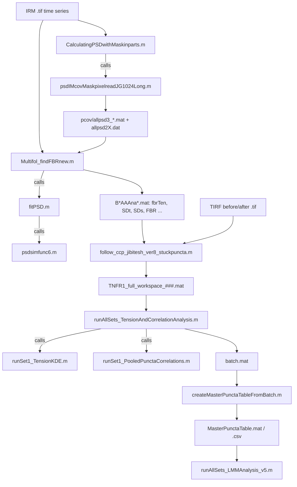

# TIRF–IRM Membrane Mechanics & Puncta Analysis Toolkit

MATLAB and ImageJ scripts for analysing live-cell **IRM** (interference reflection microscopy) membrane fluctuations together with **TIRF** puncta imaging (TNFR1 / TNFα), plus a **FLIPTR lifetime** analysis and a few **STED** colocalisation and puncta-morphology utilities.

The toolkit takes raw `.tif` time series, estimates local membrane **tension** from the power spectral density (PSD) of height fluctuations, maps TIRF puncta onto those mechanical measurements, and finally tests the relationships with correlations and linear mixed-effects models (LMM).

---

## Table of contents

1. [Pipeline overview](#pipeline-overview)
2. [Repository structure](#repository-structure)
3. [Requirements](#requirements)
4. [Quick start](#quick-start)
5. [Script index](#script-index)
6. [Data conventions](#data-conventions)
7. [Known limitations](#known-limitations)
8. [Third-party code & licence](#third-party-code--licence)

---

## Pipeline overview



Stand-alone utilities (not part of the main chain): `areafrac.m`, `Coloc1_consted_diana.m`, `concat_param.m`, `plot_FBRwisetension_colate_matrix_grey.m`, `wholefieldSDmap.m`, `for_heatmap.m`, `iicb_linescan_corr_final_all_together.m`, `flip_tr_m_cherry_final_peak_local_analysis.m`, `nuclei_thresholding.ijm`, `generate_donuts.ijm`.

---

## Repository structure

```
.
├── README.md                                   <- this file
├── README_<script>.md                          <- one README per script (see index)
│
├── PSD / mechanics
│   ├── CalculatingPSDwithMaskinparts.m
│   ├── psdIMcovMaskpixelreadJG1024Long.m
│   ├── psdsimfunc6.m
│   ├── fitPSD.m
│   ├── Multifol_findFBRnew.m
│   ├── wholefieldSDmap.m
│   └── for_heatmap.m
│
├── Tension maps & aggregation
│   ├── plot_FBRwisetension_colate_matrix_grey.m
│   └── concat_param.m
│
├── TIRF puncta
│   ├── follow_ccp_jibitesh_ver8_stuckpuncta.m
│   ├── iicb_linescan_corr_final_all_together.m
│   └── areafrac.m
│
├── FLIPTR lifetime
│   └── flip_tr_m_cherry_final_peak_local_analysis.m
│
├── Statistics (batch)
│   ├── runAllSets_TensionAndCorrelationAnalysis.m
│   ├── runSet1_TensionKDE.m
│   ├── runSet1_PooledPunctaCorrelations.m
│   ├── createMasterPunctaTableFromBatch.m
│   └── runAllSets_LMMAnalysis_v5.m
│
├── STED / ImageJ
│   ├── Coloc1_consted_diana.m
│   ├── nuclei_thresholding.ijm
│   ├── generate_donuts.ijm
│   └── ReadImageJROI.m                         <- third-party (GPL-3.0)
│
└── GettingbatchResult.docx                     <- workflow notes for the statistics chain
```

---

## Requirements

| Component | Version / note |
|---|---|
| MATLAB | R2019b or newer (several functions use `arguments` blocks) |
| Image Processing Toolbox | `adaptthresh`, `imbinarize`, `regionprops`, `drawrectangle`, `imfreehand`, `imrect`, `imtool`, `roipoly` |
| Signal Processing Toolbox | `pcov` (PSD estimation) |
| Curve Fitting Toolbox | `fit`, `fittype`, `fitoptions`, `prepareCurveData` |
| Statistics and Machine Learning Toolbox | `fitlme`, `ksdensity`, `ranksum`, `corr`, `pdist` |
| ImageJ / Fiji | Only for the two `.ijm` macros and for creating `.roi` files |

---

## Quick start

**1. PSD per pixel** – edit `d_name` in `CalculatingPSDwithMaskinparts.m`, run it, and draw the cell boundary and a background ROI when prompted.

**2. Find regions and fit tension** – run `Multifol_findFBRnew.m`. The first half detects regions and writes `AAAna*.mat`; the second half (select the `.mat` files when asked) fits the PSDs and writes `BAAAna*.mat`.

**3. Map TIRF puncta to mechanics** – run `follow_ccp_jibitesh_ver8_stuckpuncta.m` for each cell to produce `TNFR1_full_workspace_###.mat`.

**4. Statistics across sets**

```matlab
% Folder layout: parentDir/Set1, Set2, ... each holding TNFR1_full_workspace_*.mat
batchResult = runAllSets_TensionAndCorrelationAnalysis(parentDir);
save(fullfile(parentDir, 'batch.mat'), 'batchResult');          % save manually

MasterPunctaTable = createMasterPunctaTableFromBatch( ...
    fullfile(parentDir, 'batch.mat'), ...
    fullfile(parentDir, 'MasterPunctaTable.mat'), ...
    fullfile(parentDir, 'MasterPunctaTable.csv'));

runAllSets_LMMAnalysis_v5(fullfile(parentDir, 'MasterPunctaTable.mat'), 'LMM_Output');
```

Keep all `.m` files on the MATLAB path (`addpath(genpath('<repo>'))`).

---

## Script index

| Script | Type | Purpose | README |
|---|---|---|---|
| `CalculatingPSDwithMaskinparts.m` | script | Draw cell/background masks, launch per-pixel PSD | [link](README_CalculatingPSDwithMaskinparts.md) |
| `psdIMcovMaskpixelreadJG1024Long.m` | function | Per-pixel PSD (`pcov`) over masked pixels | [link](README_psdIMcovMaskpixelreadJG1024Long.md) |
| `psdsimfunc6.m` | function | Theoretical PSD model used for fitting | [link](README_psdsimfunc6.md) |
| `fitPSD.m` | function | Fit each region's PSD, return tension etc. | [link](README_fitPSD.md) |
| `Multifol_findFBRnew.m` | script | Detect regions, compute SDt/SDs, fit and filter | [link](README_Multifol_findFBRnew.md) |
| `wholefieldSDmap.m` | script | Whole-field temporal SD map | [link](README_wholefieldSDmap.md) |
| `for_heatmap.m` | script | Extract region time series for heat-map/surface plots | [link](README_for_heatmap.md) |
| `plot_FBRwisetension_colate_matrix_grey.m` | script | Render tension maps as colour images | [link](README_plot_FBRwisetension_colate_matrix_grey.md) |
| `concat_param.m` | script | Concatenate parameters across cells | [link](README_concat_param.md) |
| `follow_ccp_jibitesh_ver8_stuckpuncta.m` | script | Detect "stuck" puncta, kymographs, map to tension | [link](README_follow_ccp_jibitesh_ver8_stuckpuncta.md) |
| `iicb_linescan_corr_final_all_together.m` | script | Line-scan fluorescence vs SD correlation | [link](README_iicb_linescan_corr_final_all_together.md) |
| `areafrac.m` | script | Puncta number/area density inside a cell ROI | [link](README_areafrac.md) |
| `flip_tr_m_cherry_final_peak_local_analysis.m` | script | FLIPTR lifetime vs TNFR1-mCherry: whole-cell 5x5 ROIs and cluster line scans | [link](README_flip_tr_m_cherry_final_peak_local_analysis.md) |
| `runAllSets_TensionAndCorrelationAnalysis.m` | function | Batch runner over `Set*` folders | [link](README_runAllSets_TensionAndCorrelationAnalysis.md) |
| `runSet1_TensionKDE.m` | function | Whole-cell vs puncta tension KDEs + tests | [link](README_runSet1_TensionKDE.md) |
| `runSet1_PooledPunctaCorrelations.m` | function | Pooled puncta correlations and plots | [link](README_runSet1_PooledPunctaCorrelations.md) |
| `createMasterPunctaTableFromBatch.m` | function | Merge all sets into one puncta table | [link](README_createMasterPunctaTableFromBatch.md) |
| `runAllSets_LMMAnalysis_v5.m` | function | Linear mixed-effects models and plots | [link](README_runAllSets_LMMAnalysis_v5.md) |
| `GettingbatchResult.docx` | notes | Command sequence for the statistics chain | [link](README_GettingbatchResult.md) |
| `Coloc1_consted_diana.m` | script | STED two-channel colocalisation | [link](README_Coloc1_consted_diana.md) |
| `nuclei_thresholding.ijm` | ImageJ macro | Nuclei mask clean-up | [link](README_nuclei_thresholding.md) |
| `generate_donuts.ijm` | ImageJ macro | Ring ("donut") ROIs from existing ROIs | [link](README_generate_donuts.md) |
| `ReadImageJROI.m` | function | Read ImageJ `.roi` / `.zip` into MATLAB | [link](README_ReadImageJROI.md) |

---

## Data conventions

- **FBR** – the fixed-size (12 × 12 px) analysis windows placed on the cell; stored in `FBR` as `[row col height width]`.
- **Tension** – stored in `fbrTen(:,2)` (column 1 is the FBR index); plots label it pN/µm.
- **SDt / SDs** – temporal and spatial standard-deviation maps per FBR (`SDt(:,2)`, `SDs(:,2)`), labelled in nm in plots.
- **MappingType** – `TensionMapped` or `SDMapped` rows in the pooled puncta table.
- **FLIPTR lifetime** – `flip_tr_m_cherry_final_peak_local_analysis.m` works on three OME-TIFF images of one field (FLIPTR lifetime, mCherry lifetime, mCherry intensity) and writes `ClusterResults.csv`, `WholeCell_5x5_LocalAnalysis.csv` and `lifetime_info.mat`.
- Acquisition constants (`Inmin`, `conv`, `sps`, pixel size 0.065 µm) are **hard-coded per dataset** in several scripts; confirm them for your own data.

---

## Known limitations

- Most scripts contain **hard-coded Windows paths** (`I:\`, `L:\`, `K:\`, `H:\`, `G:\`) and must be edited before first use.
- Several scripts are **interactive** (ROI drawing, `uigetfile`, `inputdlg`, `ginput`) and cannot run headless.
- `areafrac.m` calls `min_dist`, which is **not included** in this repository.
- `follow_ccp_jibitesh_ver8_stuckpuncta.m` contains a typo (`elseoffset=0;`) – see its README.
- `flip_tr_m_cherry_final_peak_local_analysis.m` calls an undefined variable (`square_plot`) if you choose "Redraw" for the background ROI, and writes fixed output file names – see its README.

---

## Third-party code & licence

`ReadImageJROI.m` is © Dylan Muir and distributed under **GPL-3.0**; keep its header intact. Choose a licence for the remaining code (e.g. MIT or GPL-3.0 for compatibility) and add a `LICENSE` file.

## Citation

If you use this toolkit, please cite the associated publication: _add reference here_.

## Contact

_Add maintainer name and email here._
